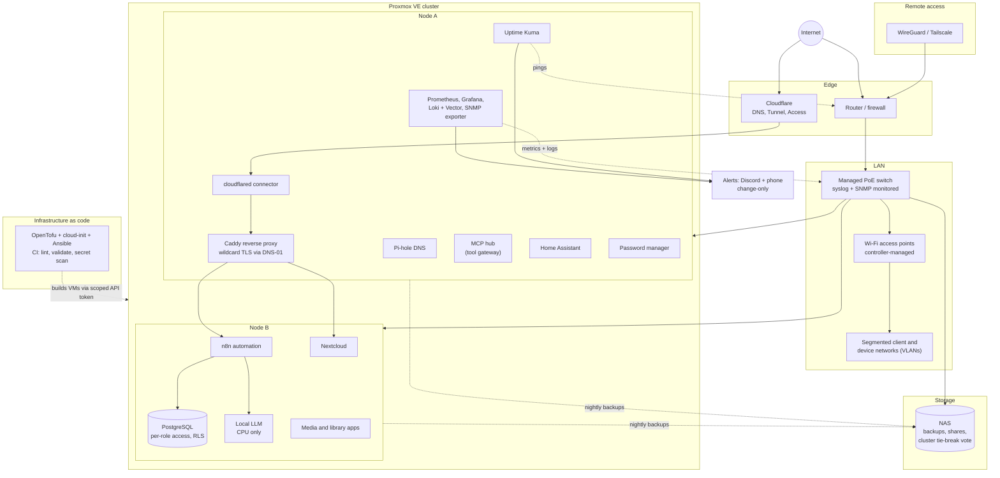

# Homelab architecture

How my lab is put together: network edge, virtualization, platform services, monitoring and backups. Addresses, hostnames and account details are left out on purpose.

See also the [network map and VLANs](network-map.md).

## Components

| Layer | What runs there | Why it is built this way |
|---|---|---|
| Edge | Cloudflare DNS, Tunnel and Access in front of a router/firewall | Services are published through an outbound tunnel instead of port forwards, and only the hostnames that need to be public are listed; everything else is LAN-only. |
| LAN | Managed PoE switch, controller-managed Wi-Fi, segmented VLANs | The switch sends syslog and SNMP to the monitoring stack, so a crash leaves evidence. See the [network map](network-map.md). |
| Virtualization | Two-node Proxmox VE cluster, VMs and LXC containers | A third quorum vote on the NAS keeps the cluster up when one node drops. Workloads were rebalanced between nodes by memory, subject to storage mounts, device passthrough and VLAN trunks. |
| Name resolution and proxy | Pi-hole and Caddy | LAN clients resolve service names to the local proxy, so traffic stays inside instead of going out and back through the tunnel. Certificates come from Let's Encrypt over DNS-01 using a token scoped to one zone. |
| Platform | n8n, PostgreSQL, a local LLM, Home Assistant, Nextcloud, a password manager, a tool gateway for AI clients | Services run in their own containers or VMs. Automation agents connect to PostgreSQL with separate least-privilege roles, and row-level security limits what each one can see. |
| Observability | Prometheus, Grafana, Loki with Vector, an SNMP exporter, Uptime Kuma | Metrics and logs come from both nodes, the switch and the router; the host firewall has explicit allow rules for the scrapers. Known gap: after the rebalance the metrics stack and Uptime Kuma both run on node A, so a node A outage blinds both views. |
| Alerting | Discord and phone push | Change-only: an alert fires when something goes down or comes back, not on every check. Routine results go into one nightly digest. |
| Backups | Nightly vzdump to the NAS, with retention | Backup errors alert. An automated restore test is next, so a missing backup shows up as a failed test rather than as silence. |
| Remote access | WireGuard and Tailscale | Remote access to the LAN goes through an encrypted VPN rather than through extra exposed services. |
| Infrastructure as code | OpenTofu, cloud-init, Ansible, GitHub Actions | Lab VMs are built, hardened, verified and destroyed from code, through an API token limited to one resource pool. |

## Related

- [Network map and VLANs](network-map.md)
- [Incident write-ups](../incidents/README.md): what broke in this setup and how it was fixed
- [Infrastructure as code for a Proxmox lab](../infrastructure-as-code/README.md)
- [Monitoring and centralized logging](../monitoring-and-logging/README.md)
