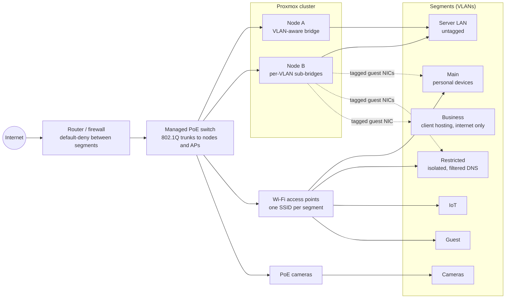

# Network map and VLANs

How the lab network is segmented, and how that shapes where workloads can run. Addresses, hostnames and account details are left out on purpose.

## Segments

| Segment | What is on it | Policy |
|---|---|---|
| Server LAN (untagged) | Proxmox nodes, NAS, infrastructure containers and VMs | Reachable from the admin segment and over the VPN; services are published outward only through the tunnel. |
| Main | Personal phones and laptops | Normal internet access; no content filtering, on purpose. |
| Restricted | Devices that need parental-style controls | Isolated from every other segment. DNS goes to the filtering resolver only, and direct DNS, DNS-over-TLS and known DNS-over-HTTPS resolvers are blocked so filtering cannot be bypassed. |
| IoT | Smart-home devices | Separate from personal devices; Home Assistant bridges to it. |
| Cameras | PoE cameras | Feed the NVR only. |
| Guest | Visitor Wi-Fi | Internet only. |
| Business | Client website hosting | Internet only; blocked from every other segment. |

Filtering is applied per segment (DNS groups attached to one segment), never network-wide.

## Design notes

- **Rule checks.** A scheduled check reads the live router configuration every minute and pushes a heartbeat to the uptime monitor only while the restricted segment's firewall rules are intact and first in order. If another write to the router wipes them, the monitor goes down within a few minutes. This was added after a stale-copy save removed those rules once.
- **Tagged guests and switch trunks.** A guest with a VLAN-tagged NIC only works on a node whose switch port carries that VLAN. One node received zero tagged frames over eight days while the other received millions, so the notification container with a restricted-segment NIC never reached its clients until it was moved to the other node. Placement is now checked against the trunk, not assumed.
- **Placement constraints.** What can move between nodes is decided by storage mounts (the NAS share is only mounted on one node), device passthrough (camera NVR accelerator, GPU) and tagged NICs. Everything else is free to move, which is how memory was rebalanced when one node ran its swap full.
- **Host firewall and monitoring.** The Proxmox host firewall defaults to drop. Metrics scraping of the node exporters had survived on long-lived connections without an allow rule, and broke the moment the monitoring container restarted. The fix is an explicit rule for the monitoring host on each node.
