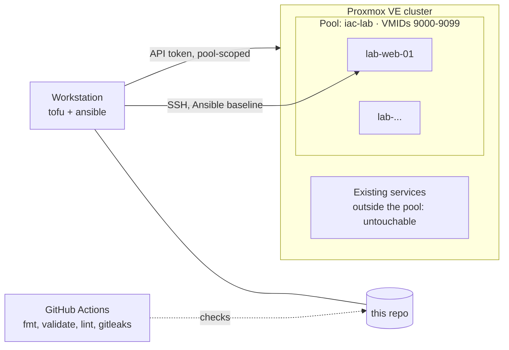

# Architecture

## Flow

1. An admin downloads the Ubuntu 24.04 cloud image once into the node's import store
   (or OpenTofu does it with `manage_image = true`). `tofu apply` then creates each VM in the
   `iac-lab` pool from the `modules/vm` module, importing the image as its disk over the API.
2. cloud-init sets the static IP, DNS, admin user and SSH key on first boot.
3. Ansible applies the baseline role: guest agent, unattended upgrades, chrony,
   SSH hardening, and a default-deny firewall.

## Design choices

| Choice | Why |
|---|---|
| OpenTofu over Terraform | Open-source licence, drop-in compatible |
| bpg/proxmox provider | Actively maintained; supports cloud-init, pools and API-only disk import |
| Cloud image, not ISO install | Boots in seconds, no installer to automate |
| Pool-scoped token | Proxmox enforces the blast radius, not just good intentions |
| No tags at create time | Proxmox checks tag permission before the VM joins its pool |
| Local state (for now) | Single operator; remote state is a planned step |
